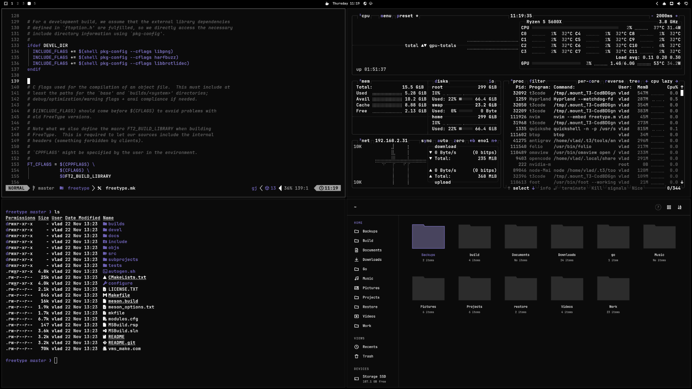
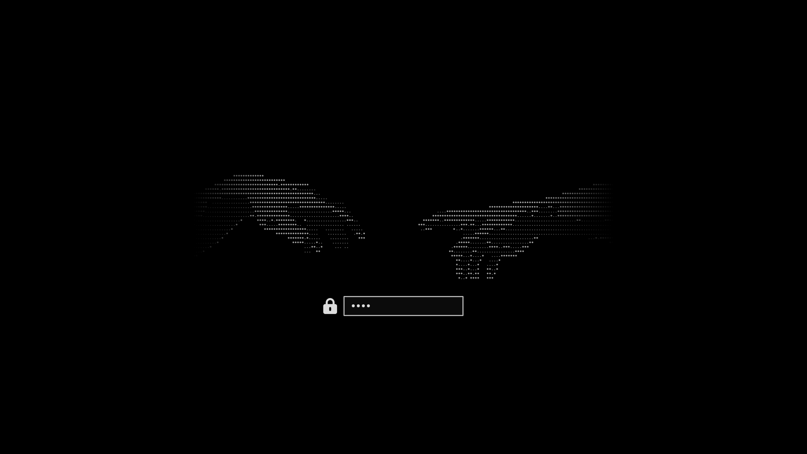
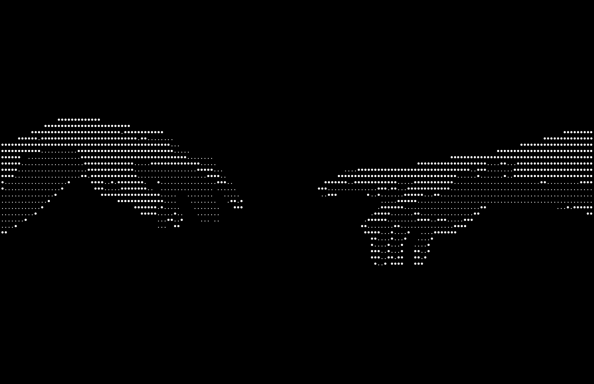
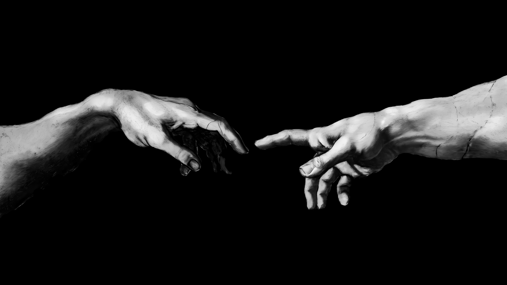
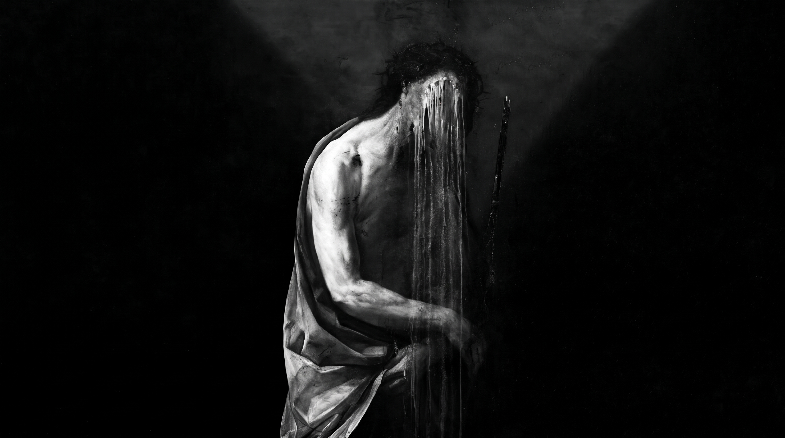

<div align="center">

# Musou

A dark monochrome theme for [Omarchy](https://omarchy.org), named after Musou Black.

Pure `#000000` top bar and overlays. `#0b0b0b` app surfaces so white text stays comfortable for long sessions. Indigo for focus and directories, muted rose for errors.

</div>

<p align="center">
  
</p>

## Install

```bash
omarchy theme install https://github.com/vladgabrielboca/omarchy-musou-theme
omarchy theme set musou
```

To apply the boot and disk-unlock screen as well:

```bash
omarchy plymouth set by theme musou
```

## Unlock Screen

<p align="center">
  
</p>

## Wallpapers

Four backgrounds ship with the theme. `0-solid-black.jpg` loads first by default.

| | |
| :---: | :---: |
|  |  |
| `0-solid-black.jpg` | `1-creation-of-adam-dots.png` |
|  |  |
| `2-creation-of-adam.png` | `3-dripping.jpg` |

## Palette

| Role | Hex |
| :--- | :--- |
| Bar & Overlays | `#000000` |
| Canvas | `#0b0b0b` |
| Selection | `#1c1c1c` |
| Text | `#dcdcdc` |
| Bright Text | `#f0f0f0` |
| Muted | `#646464` |
| Indigo (directories, prompt) | `#8c84b8` |
| Bright Indigo (accent, active selection) | `#9c94c8` |
| Rose (errors, alerts) | `#a86870` |

### What is included

- `colors.toml`: generates app configs across terminals, Hyprland, editors, and Qt.
- `shell.toml`: `#000000` bar and overlays with `1px` graphite borders on popups and notifications (`2px` on launcher and menus).
- `btop.theme`: uniform graphite panel borders and monochrome graphs, with `#9c94c8` reserved for shortcut keys and the active row.
- `eza.yml`: monochrome `ls` hierarchy with dimmed gray metadata, soft-white filenames, and indigo folders/executables.
- `unlock.png` and `preview-unlock.png`: dimmed dot-matrix *Creation of Adam* boot and login graphic on `#000000`.

<details>
<summary>Optional: activate <code>eza.yml</code> only while Musou is active</summary>

Omarchy aliases `ls` to `eza -lh`. To apply Musou's `eza.yml` automatically without overriding other Omarchy themes, save this hook to `~/.config/omarchy/hooks/theme-set.d/eza-theme` and make it executable (`chmod +x`):

```bash
#!/bin/bash
set -eu

THEME_EZA="$HOME/.local/state/omarchy/current/theme/eza.yml"
TARGET_DIR="$HOME/.config/eza"
TARGET="$TARGET_DIR/theme.yml"

if [[ -f "$THEME_EZA" ]]; then
  mkdir -p "$TARGET_DIR"
  ln -sfn "$THEME_EZA" "$TARGET"
elif [[ -L "$TARGET" ]]; then
  rm -f "$TARGET"
fi
```

Then re-apply the theme with `omarchy theme set musou`. Switching to any other theme removes the symlink and restores default `eza` colors.

</details>
